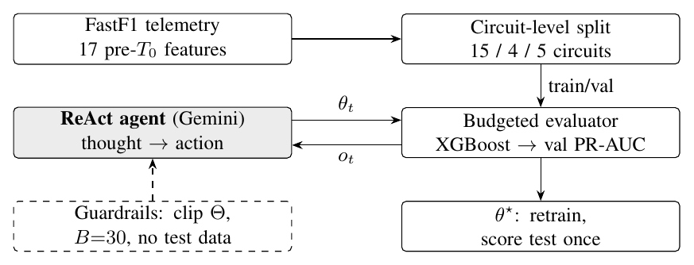
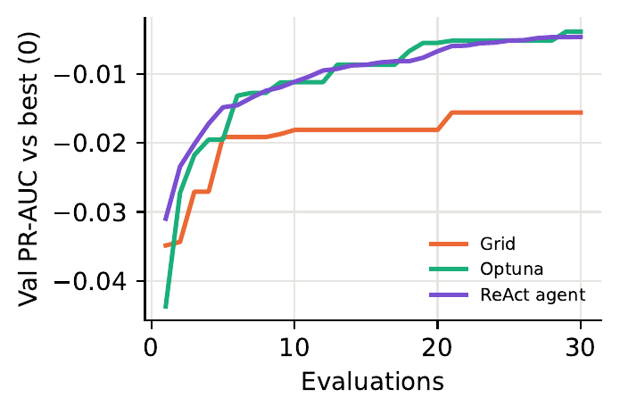
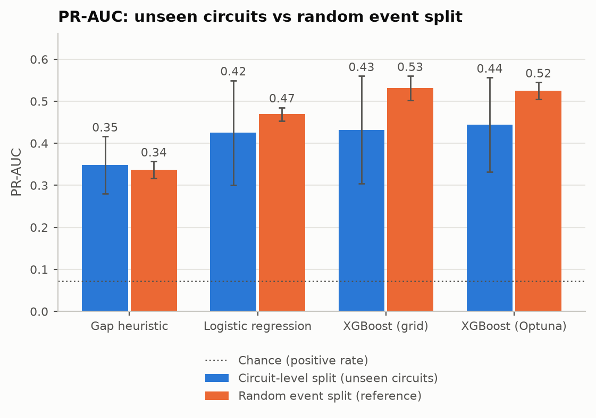
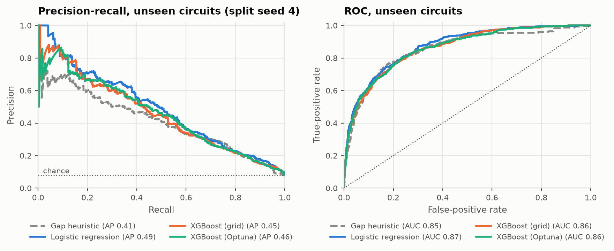

# Telemetry-Based Detection and Prediction of Formula 1 Overtaking Events

Nina Gampe, Rochester Institute of Technology
IDAI.780.01 Capstone Project

Given an overtake attempt in a Formula 1 race, can we predict from telemetry before the attempt starts whether it will succeed. This repository contains the following: event detection from FastF1 data, four baselines, and a ReAct tuning agent.




## Task and data

- **Source:** [FastF1](https://github.com/theOehrly/Fast-F1), 2023 and 2024 race sessions. 46 races, 24 circuits.
- **Attempt:** starts when the attacker is within 1.0 s of the car ahead and no earlier attempt is still open. It is followed for 40 s and counts as a **success** only if the attacker takes the position and holds it for 5 s. Only green-flag laps are used. Lap 1, pit laps, lapped defenders and attempts with a pit stop in the window are excluded.
- **Size:** 23,332 attempts, 7.0% successful ( see `report/table_dataset.md`).
- **Features (17).** Sixteen are measured at or before the start of the attempt: gap (s, m), closing speed, attacker speed and speed difference, DRS eligible/on, tyre compound and age for both cars and their differences, lap number, laps remaining and race progress.
- **Splits:** whole circuits go to train (15), validation (4) or test (5), so test circuits are unseen. This is repeated for five seeds (0-4) and results are reported as mean ± sd.
- **Metrics:** PR-AUC, ROC-AUC, F1 at a validation-chosen threshold, expected calibration error (ECE).

## Repository layout

```
.
├── baseline.py            # data download and event detection, baselines, evaluation, report
├── agent.py               # Gemini ReAct tuning agent
├── diagnose.py            # label validation check
├── data/                  # processed attempts
├── results_seed0..4/      # baseline run
├── results_agent/         # agent runs
│   └── ckpt/              # saved XGBoost models
├── report/                # baseline tables and figures
├── docs/                  # figures used in this README
├── scripts/reproduce.sh   # test, baselines, agent, demo
├── requirements.txt       # direct dependencies
└── requirements-lock.txt  # exact versions from a clean environment
```

## Installation

Python 3.11 or newer is recommended.

```bash
git clone https://github.com/ngampe/f1-overtake.git
cd f1-overtake
python -m venv .venv
source .venv/bin/activate         
pip install -r requirements.txt    
```

On macOS, XGBoost needs the OpenMP runtime: `brew install libomp`

## Data preparation

The processed attempt files are already in `data/`

To rebuild them from scratch:

```bash
python baseline.py build --years 2023 2024 --rounds all
```

`build` downloads each race, detects overtake attempts, labels them, and writes `data/events_<year>_<round>.csv`. Re-running skips races already built

## Usage

quick checks:

```bash
bash scripts/reproduce.sh test      # unit tests for event detection
python baseline.py run --synthetic --out results_test   # smoke test on fake data
```

**Baselines (chkpt 2).** Trains and tests the four baselines on five circuit splits:

```bash
bash scripts/reproduce.sh baselines
# equivalent to, for each seed s in 0..4:
#   python baseline.py run --data-dir data --out results_seed$s --seed $s
# then:
#   python baseline.py report --results "results_seed*" --data-dir data --out report
```

**ReAct tuning agent (chkpt 3).** Runs the agent three times per split, plus grid search and Optuna under the same objective, and writes logs, checkpoints and tables to `results_agent/`
```bash
export GEMINI_API_KEY=...        
export GEMINI_MODEL=gemini-3.8-flash   
bash scripts/reproduce.sh agent
```

**Batch demo.** loads a saved checkpoint and scores a class-balanced batch of ten events from circuits the model didn't see during training:

```bash
bash scripts/reproduce.sh demo
# or: python agent.py demo --seed 0 --n 10 [--method agent_run0 | optuna | grid]
```

Each row shows the circuit, the two car numbers, gap, DRS state, the predicted success probability, the yes/no call and the true outcome.

## Results

All numbers are on held-out circuits. For the agent, the three runs within each split are averaged first, so every row has the same five-split basis.

| Method | PR-AUC | ROC-AUC | F1 | ECE |
|---|---|---|---|---|
| Gap heuristic | 0.348 ± 0.068 | 0.831 ± 0.033 | 0.360 ± 0.052 | n/a |
| Logistic regression | 0.425 ± 0.125 | 0.859 ± 0.039 | 0.442 ± 0.088 | 0.018 ± 0.014 |
| XGBoost (grid search, 36 configs) | 0.433 ± 0.128 | 0.863 ± 0.041 | 0.443 ± 0.085 | 0.024 ± 0.010 |
| XGBoost (Optuna, 30 trials) | **0.446 ± 0.114** | **0.867 ± 0.040** | 0.449 ± 0.082 | 0.019 ± 0.007 |
| XGBoost (ReAct agent, 30 evaluations) | 0.444 ± 0.117 | 0.866 ± 0.039 | **0.453 ± 0.086** | 0.020 ± 0.009 |

The positive rate is 7.0%. Full tables: `report/table_results.md` and `results_agent/table_agent.md`.

**Tuning efficiency.** Best validation PR-AUC so far versus the number of evaluations, averaged over five splits


| | Grid | Optuna | ReAct agent |
|---|---|---|---|
| Regret-AUC (lower is better) | 0.019 | 0.011 | 0.010 |

**Baseline figures:**





More figures are in `report/`.

**Results**

- The learned models beat the gap heuristic on average, but logistic regression, grid search, Optuna and the agent are not discernable because their mean PR-AUC differs by 0.02 or less
- The agent ties with optuna and is about 0.01 ahead of grid search and better on 4 of 5 splits. Adds a one sentence rationale for every trial (`results_agent/agent_trace_seed*.log`); these are readable explanations, not verified.
- Most of the variance comes from which specific circuits are held out.
- XGBoost shows mild circuit memorization so it is suggestive but not conclusive with five splits.

## Limitations and future work

Only green-flag events are included, the labels are automated, and there are five circuit splits rather than full leave-one-circuit-out. SHAP feature attributions and leave-one-circuit-out evaluation are planned for the final study.

## References and acknowledgments

This code builds on the following open-source work and ideas, and I thank their authors:

- Schaefer, P. and the FastF1 contributors. *FastF1*, https://github.com/theOehrly/Fast-F1 (race telemetry and timing data).
- Chen, T. and Guestrin, C. XGBoost: A Scalable Tree Boosting System. *KDD*, 2016.
- Akiba, T., Sano, S., Yanase, T., Ohta, T. and Koyama, M. Optuna: A Next-generation Hyperparameter Optimization Framework. *KDD*, 2019.
- Yao, S., Zhao, J., Yu, D., Du, N., Shafran, I., Narasimhan, K. and Cao, Y. ReAct: Synergizing Reasoning and Acting in Language Models. *ICLR*, 2023.
- Pedregosa, F. et al. Scikit-learn: Machine Learning in Python. *JMLR* 12, 2011.
- Tulabandhula, T. and Rudin, C. Tire Changes, Fresh Air, and Yellow Flags: Challenges in Predictive Analytics for Professional Racing. *Big Data* 2(2), 2014 (motivating prior work on race prediction).
- The tuning agent calls Google Gemini through the `google-genai` SDK.

F1 timing data is accessed through FastF1 and is used here for coursework.
